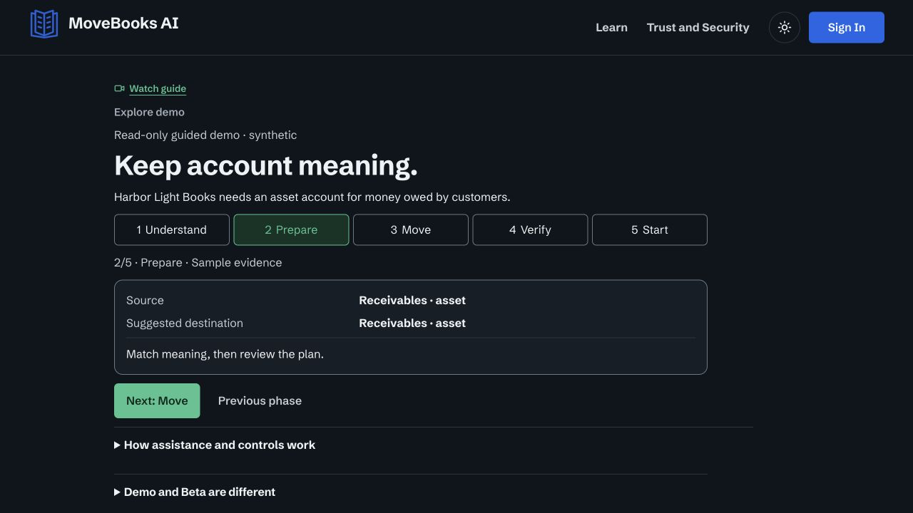
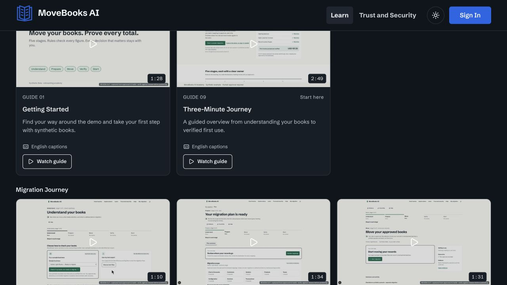

# MoveBooks AI

**Move your books. Keep your confidence.**

MoveBooks AI guides a synthetic accounting migration from readiness and mapping review to
reconciliation and **Verified First Productive Use**. Gemini explains uncertain mappings; an
independent Reviewer challenges the recommendation. Humans approve consequential decisions,
and deterministic checks remain authoritative.

This is not commercial production readiness, a real accounting-provider integration or an unrestricted AI service.

[**Launch MoveBooks AI**](https://movebooks-si.web.app/) ·
[**Explore the read-only demo**](https://movebooks-si.web.app/simulator) ·
[**Watch Three-Minute Journey · 2:49**](https://movebooks-si.web.app/learn?tab=videos#lesson-09)

[Eight-artifact showcase](docs/showcase/README.md) · [Nine-video Academy](docs/video-academy/README.md) ·
[Acceptance and evidence](docs/showcase/EVIDENCE.md) · [Developer setup](#developer-setup)

[](https://movebooks-si.web.app/simulator)

*Public signed-out capture, 24 October 2026 IST: sample demo evidence, not an executed migration
or a Gemini output. [Screenshot provenance](docs/showcase/README.md#05-prototype-showcase).*

## A three-minute review

1. **See the journey:** explore the public demo or captioned walkthrough above. Neither requires a model call.
2. **Inspect the working MVP:** approved accounts use [My Migration](https://movebooks-si.web.app/workspace).
   Existing saved analysis can be reopened without running Gemini. Access remains restricted.
3. **Understand the decisions:** review the [eight showcase artifacts](docs/showcase/README.md),
   [architecture](docs/architecture/beta-v1-agent-architecture.md) and [dated acceptance receipt](docs/showcase/EVIDENCE.md#four-p0-acceptance).

The customer problem is the handover after import: **Did the right records move? Do the numbers
reconcile? Can the business start working?** This synthetic MVP demonstrates a completion contract,
not measured customer savings or adoption. The [North Star](docs/METRICS_FRAMEWORK.md) is the share
of eligible journeys reaching Verified First Productive Use.

## Five stages, one completion contract

| Stage | User outcome | Safeguard |
| --- | --- | --- |
| **Understand** | Know the source, scope and readiness blockers | Schema, required-field and reference checks. |
| **Prepare** | Review the plan and account mappings | Explicit, current human approval. |
| **Move** | Execute approved synthetic batches and resolve exceptions | Checkpoints, bounded retries and idempotency. |
| **Verify** | Reconcile records and review configuration | Exact financial checks; approval cannot waive failure. |
| **Start** | Complete onboarding and the first synthetic productive task | Deterministic verification of First Productive Use. |

[Product constitution](docs/PRODUCT_CONSTITUTION.md) · [FPU contract](docs/architecture/onboard-fpu.md) ·
[User guide](https://movebooks-si.web.app/guide).

## Released and accepted — October 2026

| Functional requirement | Accepted evidence |
| --- | --- |
| **P0-01 —  Access: PASS** | Approved Account B accessed its authenticated workspace; previously accepted evidence retained. |
| **P0-03 — Five-stage migration: PASS** | Existing synthetic migration, reconciliation and First Productive Use previously accepted. |
| **P0-04 — Gemini Advisor + independent Reviewer: PASS** | Owner visually verified saved production Advisor explanation, Reviewer **QUESTION** assessment, grounding and uncertainty on the correct existing mapping. The panel states: “Historical analysis restored. No model was called.” |
| **P0-05 — Isolation and financial safeguards: PASS** | Previously accepted ownership, isolation and human-approval evidence retained. |

The production visual check is **owner-reported screenshot evidence**; earlier authenticated payload
and protected-preview checks separately verified record pairing and restoration. Server logs cover
specific earlier read-only windows, not every action during the later manual check. No new inference
was needed for closeout. [Evidence sources, release identity and limitations](docs/showcase/EVIDENCE.md).

## Agentic AI with explicit authority

**Rules verify. AI predicts. GenAI reasons. Agents orchestrate and act. Humans govern consequential decisions.**
This responsibility model does not imply that every specialist calls a model or that predictive accuracy is proven.

| Role | Responsibility and boundary |
| --- | --- |
| **Gemini Advisor** | Explains supplied evidence, uncertainty and possible next steps. Cannot approve, migrate, reconcile or post an invoice. |
| **Independent Reviewer** | Challenges a proposal using a distinct role, evidence projection and output contract. Independence does not mean universally hiding the Advisor proposal. |
| **Stage agents and tools** | Coordinate allowed lifecycle transitions, bounded evidence reads and deterministic financial checks. Missing evidence stays unknown. |
| **Human approver** | Authorizes consequential mappings, plans, remediations and the exact first invoice. Advice is not consent. |

The accepted saved example recommends human escalation and records a Reviewer **QUESTION** outcome;
it demonstrates preserved disagreement and uncertainty, not automatic approval or a model-accuracy benchmark.
[Agent workflows](docs/architecture/AGENT_WORKFLOWS.md) · [AI constitution](docs/AI_AGENT_CONSTITUTION.md) ·
[Trust controls](docs/TRUST.md).

## Architecture and product showcase

| Layer | Purpose |
| --- | --- |
| Next.js / React / TypeScript | Guided journey, authenticated workspace and evidence review. |
| Python / FastAPI | Typed workflow contracts, deterministic agents and tools. |
| PostgreSQL / Cloud SQL | Owner-scoped snapshots, reconciliation and audit state. |
| Firebase / Google Cloud | Identity, public hosting and a server-side proxy to the protected API. |
| Google ADK / Gemini | Bounded advisory reasoning under restricted evaluation controls. |

Built on Google Cloud with Google Gemini; **MoveBooks AI remains independent and provider-neutral**.
[Runtime architecture](docs/architecture/google-native-runtime.md) · [Threat model](docs/security/THREAT_MODEL.md).

The [eight-artifact showcase](docs/showcase/README.md) preserves the process, use cases, multi-agent
swimlane, proposed wireframes, genuine screenshots, solution architecture, technology stack and roadmap.
Original **18 October design exports** remain dated; planned wireframes and future services are not
presented as deployed capabilities. Editable sources, attribution and original image bytes are retained.

## Video Academy

[](https://movebooks-si.web.app/learn?tab=videos)

**Nine published modules with English captions**, from Getting Started through Three-Minute Journey.
[Exact titles, measured durations and all video/caption links](docs/video-academy/README.md).
Watch-guide playback remains usable; the known thumbnail defect is deferred. The conceptual Product
Vision film and older submission recordings are separately labelled in the archive.

## Validation and known limits

- **Previously validated release candidate:** 992 frontend tests, 93 offline agent tests, build,
  TypeScript, lint and web dependency audit passed. The runtime-remediated image passed the unchanged
  Grype High/Critical gate at release. These are dated results, not a fresh repository-wide green claim.
- **Production checks:** earlier release smoke checks passed 34/34 public checks. Owner production
  verification subsequently closed saved-result acceptance. [Evidence scope](docs/showcase/EVIDENCE.md).
- **Security remains separately tracked:** [OpenTelemetry Issue #42](https://github.com/JEMathew/movers-and-ledgers/issues/42)
  is open; repository-wide CI is **not green**. [PR #41](https://github.com/JEMathew/movers-and-ledgers/pull/41)
  contains a separately validated web security fix. Functional MVP acceptance grants no security exception or merge approval.
- **Bounded audience and data:** non-commercial, synthetic-data-only evaluation;No live accounting-provider integration, customer-data migration or commercial-readiness claim.
- **Deferred/unverified:** Academy thumbnails; `movebooks.ai` custom-domain status; real connectors,
  broader model evaluation and customer outcomes. Use the verified `movebooks-si.web.app` URL.

[Historical local journey](docs/submission/final-experience/evidence/journey-fa13e9e/README.md) ·
[Offline evaluation](docs/submission/final-experience/evidence/agents/offline-agent-eval.json) ·
[Evaluation principles](docs/EVALUATION_PRINCIPLES.md) · [Roadmap](docs/showcase/README.md#08-future-development-roadmap).
GitHub main and this documentation branch are not the production source ledger; exact serving release
provenance is recorded in the [evidence receipt](docs/showcase/EVIDENCE.md#released-product-identity).

## Developer setup

Prerequisites: Node.js 22+, Python 3.11+ (the Makefile defaults to `python3.11`); Docker is optional.

```bash
make setup
make dev         # API: http://localhost:8000/docs; web: http://localhost:3000
```

`make dev-api` and `make dev-web` run separately; both must be running. The web stays on port 3000
and the local API permits `localhost:3000` or `127.0.0.1:3000`. Alternatively use
`docker compose up --build`. Default local development is deterministic and needs no Google
credentials or paid cloud resources. Local demo identity is not public-Beta authentication.

```bash
make test
make lint
python3 scripts/repository_checks.py
```

[Contributing](CONTRIBUTING.md) · [Documentation index](docs/README.md) ·
[Deployment history](docs/deployment/public-beta.md) ·
[Release remediation](docs/reviews/demo-loader-release-remediation.md) ·
[Mapping reconsideration](docs/reviews/mapping-reconsideration.md).

### Reference Use & Intellectual Property

**Reference implementation:** This public repository is provided primarily for demonstration, evaluation, learning, and portfolio purposes. MoveBooks AI and Movers & Ledgers remain independent product concepts. Public access to the repository does not by itself grant rights to commercially reproduce, rebrand, resell, or redistribute the product beyond the permissions explicitly provided in the repository license.

MoveBooks AI is an independent product concept developed by **Movers & Ledgers**.

This repository is made publicly available primarily for **demonstration, learning, portfolio, evaluation, and reference purposes**.

The repository may be reviewed to understand the product concepts, architecture, agentic AI patterns, migration workflows, user experience, evaluation approaches, and engineering practices used in MoveBooks AI.

Public availability of this repository should not be interpreted as a waiver of intellectual property rights or as authorization to commercially reproduce, redistribute, rebrand, resell, or create substantially derivative commercial products from MoveBooks AI unless explicitly permitted by the applicable repository license.

Product names, branding, product concepts, proprietary migration intelligence, domain-specific knowledge assets, designs, documentation, datasets, and other intellectual property associated with **Movers & Ledgers** and **MoveBooks AI**remain subject to their respective intellectual property rights.

MoveBooks AI is an independent synthetic product concept and does not represent, reproduce, or claim to describe the internal products, systems, APIs, architectures, roadmaps, or implementation details of Intuit, QuickBooks, or any other accounting software provider.

Where third-party technologies, frameworks, libraries, trademarks, or services are referenced, those remain the property of their respective owners.

For permitted use of the source code, refer to the repository's `LICENSE` file.
