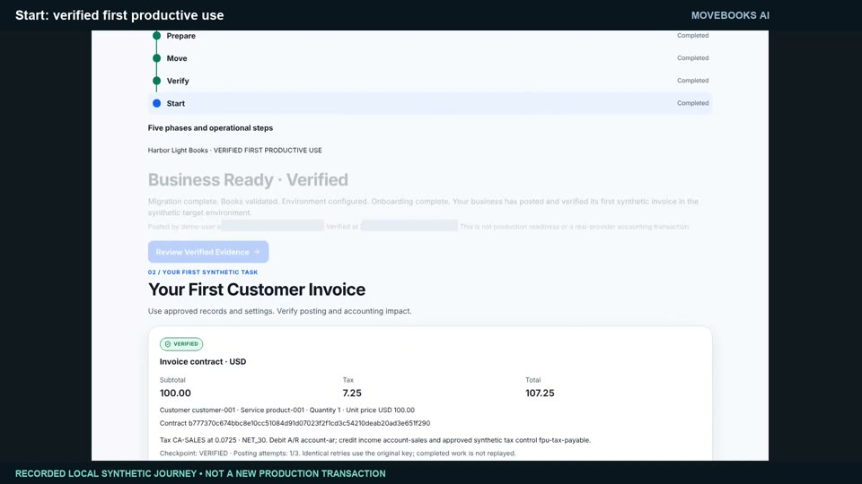
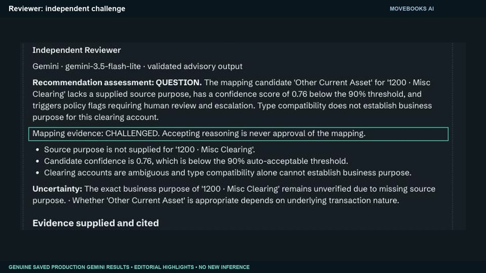
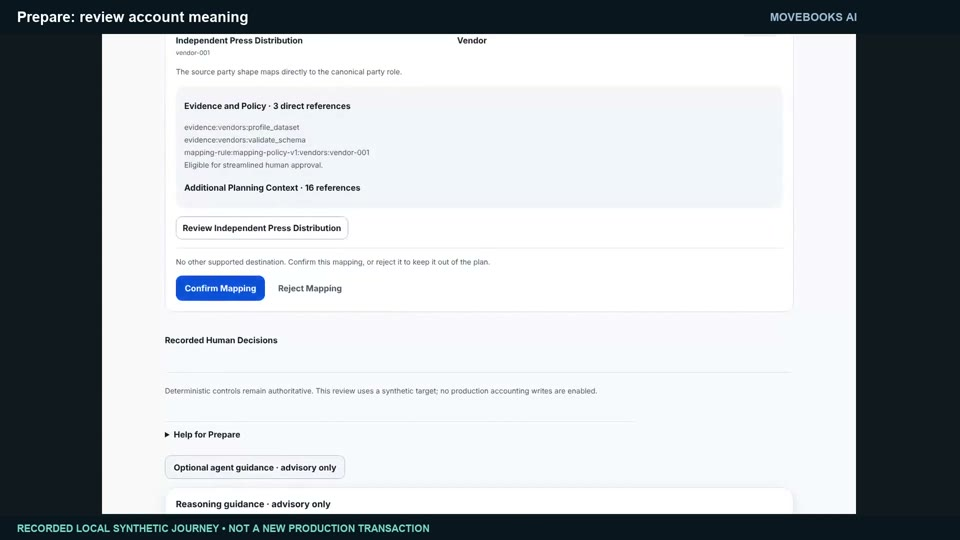
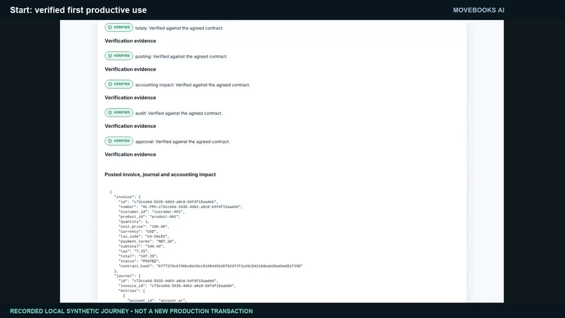

# MoveBooks AI

**Move your books. Keep your confidence.**

**MoveBooks AI — Built on Google Cloud and powered by Gemini AI.**

Accounting migration is more than an import: did the right records move, do the numbers
reconcile, and can the business start working? MoveBooks AI guides the five-stage journey
from readiness and account mapping to **Verified First Productive Use**.

Gemini explains uncertain mappings. An independent Reviewer challenges the recommendation.
People approve consequential decisions; deterministic checks verify the financial outcome.

[**Explore the public demo**](https://movebooks-si.web.app/simulator) ·
[**Open My Migration**](https://movebooks-si.web.app/workspace) ·
[Getting Started Guide](https://movebooks-si.web.app/guide)

**Non-commercial, synthetic-data-only MVP for approved evaluation.** Do not enter real customer or production
provider data. Account access and AI assistance are restricted; this is not a live accounting-provider
integration, unrestricted AI service or commercial-readiness claim.

## See MoveBooks AI in Action

Real product recordings and genuine saved Gemini results, with English captions and transcripts.
The local synthetic journey and separate production/preview evidence are identified in the videos.
Viewing saved results does not trigger another model call. [Recording scope and provenance](docs/product-demos/README.md).

### Complete Customer Journey — 7:14

[](https://movebooks-si.web.app/#demo-complete-customer-journey)

Follow the five stages from readiness and mapping through reconciliation and Verified First Productive Use.

[**Watch · 7:14**](https://movebooks-si.web.app/#demo-complete-customer-journey) · [English captions](docs/product-demos/complete-customer-journey.vtt) · [Transcript](docs/product-demos/complete-customer-journey.txt) · [Chapters](docs/product-demos/complete-customer-journey.chapters.txt)

### Gemini Advisor & Independent Reviewer — 2:34

[](https://movebooks-si.web.app/#demo-gemini-advisor-independent-reviewer)

Examine genuine saved Gemini explanations, grounding, uncertainty and an independent Reviewer’s QUESTION assessment. Human approval remains essential.

[**Watch · 2:34**](https://movebooks-si.web.app/#demo-gemini-advisor-independent-reviewer) · [English captions](docs/product-demos/gemini-advisor-independent-reviewer.vtt) · [Transcript](docs/product-demos/gemini-advisor-independent-reviewer.txt) · [Chapters](docs/product-demos/gemini-advisor-independent-reviewer.chapters.txt)

### Assessment & Preparation — 1:39

[](https://movebooks-si.web.app/#demo-assessment-preparation)

Explore readiness, source evidence and account mappings before approving the next step.

[**Watch · 1:39**](https://movebooks-si.web.app/#demo-assessment-preparation) · [English captions](docs/product-demos/assessment-preparation.vtt) · [Transcript](docs/product-demos/assessment-preparation.txt) · [Chapters](docs/product-demos/assessment-preparation.chapters.txt)

### Migration, Verification & FPU — 2:41

[](https://movebooks-si.web.app/#demo-migration-verification-fpu)

Review recorded recovery checkpoints, deterministic reconciliation and a verified synthetic accounting task.

[**Watch · 2:41**](https://movebooks-si.web.app/#demo-migration-verification-fpu) · [English captions](docs/product-demos/migration-verification-fpu.vtt) · [Transcript](docs/product-demos/migration-verification-fpu.txt) · [Chapters](docs/product-demos/migration-verification-fpu.chapters.txt)

## Verified MVP Capabilities

| Stage | Customer outcome | Safeguard |
| --- | --- | --- |
| **Understand** | Understand the source, scope and readiness. | Schema, required-field and reference checks. |
| **Prepare** | Review the plan, mappings and supporting evidence. | Explicit human approval of consequential decisions. |
| **Move** | Execute approved synthetic batches and resolve exceptions. | Checkpoints, bounded retries and idempotency. |
| **Verify** | Reconcile records and review configuration. | Exact financial checks that approval cannot waive. |
| **Start** | Complete onboarding and the first productive accounting task. | Deterministic verification of synthetic First Productive Use. |

[Product constitution](docs/PRODUCT_CONSTITUTION.md) · [First Productive Use contract](docs/architecture/onboard-fpu.md) ·
[Capability evidence](docs/showcase/EVIDENCE.md#four-p0-acceptance).

## Gemini advice, independent review, human authority

- **Explicit assistance:** an authorized user requests AI help for the selected mapping.
- **Gemini Advisor:** explains supplied evidence, recommendation, uncertainty and escalation.
- **Independent Reviewer:** separately assesses the recommendation and can question or challenge it.
- **Human decision:** accepting reasoning does not approve a mapping, migration or invoice.
- **Saved analysis:** existing results can be restored for review without another model call.

The genuine saved example recommends escalation and retains a Reviewer **QUESTION / CHALLENGED**
outcome. It demonstrates grounded disagreement, not automatic approval or a model-accuracy benchmark.
Recorded results are distinct from current real-time inference availability, which remains restricted.

[Agent workflows](docs/architecture/AGENT_WORKFLOWS.md) · [AI constitution](docs/AI_AGENT_CONSTITUTION.md) ·
[Trust controls](docs/TRUST.md).

## Architecture and product showcase

| Layer | Purpose |
| --- | --- |
| Next.js / React / TypeScript | Guided journey, authenticated workspace and evidence review. |
| Python / FastAPI | Typed workflow contracts, bounded agents and deterministic tools. |
| PostgreSQL / Cloud SQL | Owner-scoped snapshots, reconciliation and audit state. |
| Firebase / Google Cloud | Identity, public hosting and protected API access. |
| Google ADK / Gemini | Bounded advisory reasoning under restricted evaluation controls. |

Explore the [eight-artifact showcase](docs/showcase/README.md): process, use cases, multi-agent
swimlane, wireframes, genuine screenshots, solution architecture, technology stack and roadmap.
Design proposals are identified separately from implemented capabilities; original sources remain available.

[Runtime architecture](docs/architecture/google-native-runtime.md) · [Threat model](docs/security/THREAT_MODEL.md).

## Learn with the Video Academy

The [nine-module Video Academy](docs/video-academy/README.md) offers captioned guides from
Getting Started through Three-Minute Journey. These learning modules complement the four product demos.

[**Open the Academy**](https://movebooks-si.web.app/learn?tab=videos) ·
[User guide](https://movebooks-si.web.app/guide) · [Trust and Security](https://movebooks-si.web.app/trust).

## Evaluation scope and technical evidence

MoveBooks AI is an independent, provider-neutral synthetic MVP. Financial authority remains with
people, and deterministic reconciliation remains authoritative. No customer-data migration,
live provider connectivity or commercial readiness is claimed.

**An unresolved dependency security finding remains tracked in [Issue #42](https://github.com/JEMathew/movers-and-ledgers/issues/42).**
Review [security and release evidence](docs/showcase/EVIDENCE.md) before self-hosting or considering deployment.
This presentation grants no security exception. Detailed acceptance records, scan results and
source provenance remain available there without turning the product introduction into a release log.

## Developer setup

Prerequisites: Node.js 22+, Python 3.11+; Docker is optional.

```bash
make setup
make dev         # API: http://localhost:8000/docs; web: http://localhost:3000
```

Run both API and web. Default local development is deterministic and requires no paid cloud resources.
Local demo identity is not public-Beta authentication.

```bash
make test
make lint
python3 scripts/repository_checks.py
```

[Contributing](CONTRIBUTING.md) · [Documentation index](docs/README.md) ·
[Deployment and release evidence](docs/deployment/public-beta.md).

### Reference Use & Intellectual Property

**Reference implementation:** This public repository is provided primarily for demonstration, evaluation, learning, and portfolio purposes. MoveBooks AI and Movers & Ledgers remain independent product concepts. Public access to the repository does not by itself grant rights to commercially reproduce, rebrand, resell, or redistribute the product beyond the permissions explicitly provided in the repository license.

MoveBooks AI is an independent product concept developed by **Movers & Ledgers**.

This repository is made publicly available primarily for **demonstration, learning, portfolio, evaluation, and reference purposes**.

The repository may be reviewed to understand the product concepts, architecture, agentic AI patterns, migration workflows, user experience, evaluation approaches, and engineering practices used in MoveBooks AI.

Public availability of this repository should not be interpreted as a waiver of intellectual property rights or as authorization to commercially reproduce, redistribute, rebrand, resell, or create substantially derivative commercial products from MoveBooks AI unless explicitly permitted by the applicable repository license.

Product names, branding, product concepts, proprietary migration intelligence, domain-specific knowledge assets, designs, documentation, datasets, and other intellectual property associated with **Movers & Ledgers** and **MoveBooks AI**remain subject to their respective intellectual property rights.

MoveBooks AI is an independent synthetic product concept and does not represent, reproduce, or claim to describe the internal products, systems, APIs, architectures, roadmaps, or implementation details of Intuit, QuickBooks, or any other accounting software provider.

Where third-party technologies, frameworks, libraries, trademarks, or services are referenced, those remain the property of their respective owners.

For permitted use of the source code, refer to the repository's `LICENSE` file.
