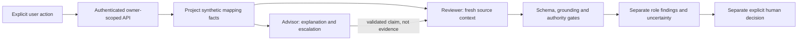

# MoveBooks AI — Gemini evidence for technical review

> Current Track B status: [October 20 release review](TRACK-B-RELEASE-REVIEW.md). The prior checkpoint narrative below is retained as dated history; it is not the latest UX acceptance, test-count or source-candidate decision. All approved scope remains OPEN where incomplete; no omission or release waiver is authorized.

**October 20 addendum, not a revision of the October 18 submission.** This evidence supports a bounded synthetic prototype. It does not establish production readiness, broad accounting accuracy, hosted UX integration or an official judging score.

Persona: an accountant or migration owner deciding how a legacy chart of accounts should map into a cloud accounting system. The exception is `1200 · Misc Clearing`: type compatibility does not establish the account's business purpose. The useful outcome is an explained unresolved decision, source-purpose questions and a human approval boundary—not an automatically applied mapping.

The [official rubric](https://aibuildercup.com/themes.html), checked October 20, assigns 40% technical merit/GenAI, 25% problem alignment/impact, 25% innovation/creativity and 10% UX/solution design. Those weights organize the evidence below, without predicting a score. The [selected BFSI challenge](../submission/problem-statement.md) concerns financial-process risk and informed decisions; no fraud-detection capability is asserted.

## Provenance: four distinct evidence classes

| Class | What can be attributed | What cannot be attributed |
| --- | --- | --- |
| **A — October 18 submitted-era implementation** | Repository release reference `16e31e93fbab5906f9e78d9f0ed70b581a878131`; [historical October 18 run report](../reviews/live-gemini-l1-16e31e9.md), documented in commit `a615fe9ba519eeb68908a315c6a9b19ae696d1fd`, reports 14/14 harness checks, four calls and an independent mapping challenge | The report is owner-reported and says raw evidence is privately held; it was not independently revalidated here. Exact portal-submitted bytes/receipt are not established by the available packaging documents. Do not substitute today's checkout for the submitted artifact |
| **B — October 20 live evaluation** | Locally hash-verified sanitized outputs and trace metadata for one real Advisor/Reviewer evaluation, with four consumed attempts | Not the October 18 run; not deployed-product inference; no repeat authorization |
| **C — Current deterministic/mock capabilities** | Tests of API contracts, owner/selection/account isolation, independent review contexts, failure handling and human-control boundaries; new account/citation hardening | These post-deadline fixes and mock cases were not in the original submission and are not new live results |
| **D — Planned/unimplemented** | Reviewed-as-document source-evidence proposal, metric definitions, future broader case evaluation and refreshed-UX integration requirements | No durable evidence-request workflow, working Request Source Evidence control, combined-UX acceptance or automatic financial correction |

The October 18 Reviewer report describes a fresh mapping challenge without seeing Advisor output. The October 20 paired Reviewer separately receives the Advisor recommendation as an untrusted claim, alongside independently projected source facts. Do not conflate these two contracts or their evidence.

## Technical merit and GenAI implementation — 40%

Actual GenAI roles: one Advisor explains the current proposal and uncertainty; one Reviewer challenges that recommendation against source facts. Both use Google ADK with strict output models and a read-only `read_evidence` tool. Separate sessions/context projections establish procedural separation, not statistically independent model errors. The same model can share blind spots.

Gemini contributes natural-language explanation and examination of the supplied claim. It is **not necessary for financial authorization or the deterministic safety decision**: the safe fallback already escalates this ambiguous case. The observed live pair demonstrates an understandable explanation and source-purpose challenge; incremental benefit over rules, reduced migration time and customer impact have not been measured. This is a bounded use of generated reasoning, not a claim that a language model verifies accounting truth.

Current API: explicit confirmed POST; authenticated owner; synthetic case admission; independently retained role outputs; safe fallback; no write tools or automatic approval. See [exact contract](HANDOFF.md) and [generated schemas](analysis-api-schema.json). The harness additionally counts the assembled request, caps inputs at 50,000 and outputs at 2,048, pins LOW thinking, disables SDK retries and atomically reserves at most four attempts in a persistent single-run ledger. That ledger is consumed. Harness controls do not automatically apply to future regular UI inference.

## October 20 measured evidence

Endpoint: `https://aiplatform.googleapis.com`, project `movebooks-ai`, location `global`, model and returned model version `gemini-3.5-flash-lite` (no more specific serving revision exposed). Recorded execution window: **11:48:40–11:48:49 UTC**.

| Role | Calls / evidence reads | Reported input / candidate output | Transport latency per call | Result |
| --- | --- | --- | --- | --- |
| Advisor | 2 / 1 | 2,524 / 329 | 959, 1,539 ms | ESCALATED; recommendation to seek qualified human investigation |
| Reviewer | 2 / 1 | 2,683 / 228 | 808, 1,274 ms | ACCEPT investigation recommendation, CHALLENGED mapping; inspect source purpose |

Transport latency sums to 4,580 ms, not end-to-end user latency or a service percentile. The application recorded 6,303 ms for Advisor; a separate Reviewer application latency is not present in the retained response. Do not substitute transport time for that missing field.

The Reviewer flags missing purpose and unknown underlying transactions. Agreement was on escalation; neither role established the correct classification. No live recommendation disagreement was observed. Reference IDs link both outputs to the synthetic mapping; the recommendation and finding remain separately inspectable.

Known reported usage: **5,207 input / 557 candidate-output tokens**. At recorded rates, the component estimate is **$0.0029546**. Thinking counts are missing; complete billable cost is **UNVERIFIED**. countTokens returned 4,382 input tokens, 825 below generation-reported input; raw wire bodies were not retained, so the cause cannot be proven. The historical application incorrectly marked usage complete; a subsequent adapter fix labels missing components partial without rewriting originals.

Original bundle SHA-256: `b87d0537e5b74203236b66b63379f263a062d4f756cc2b5b5679f69363f313f7`. Original local bundle and role-response files remain untracked and immutable. The tracked [derived fixture](../../tests/fixtures/gemini-recorded-pair.json) provides portable exact response/usage excerpts, with source provenance and no authorization ledger. See [reconciliation](evidence/post-inference-reconciliation.json) for the local accounting receipt.

## Problem alignment and impact — 25%

The prototype makes an unsafe assumption visible before a migration owner approves it: an account name and compatible target type cannot establish purpose. It can help an accountant distinguish supplied facts from model inference and identify what evidence is missing.

Evidence: real escalation of one synthetic exception, unchanged financial/business state, independent human decisions, plus [five exception categories](FINANCIAL-QUALITY-MATRIX.md) exercised through synthetic controls. These demonstrate workflow behavior, not customer savings, reduced error rate or financial correctness. No customer records or real accounting integrations were used.

## Innovation and creativity — 25%

The design combines an explanatory Advisor, a separate challenge role and deterministic authorization boundaries. The Reviewer assesses the Advisor claim without treating it as source evidence; ACCEPT can coexist with CHALLENGED. This distinction keeps agreement from becoming approval.

This is a demonstrated design choice, not a claim of novelty over all competitors. The source-evidence lifecycle could turn uncertainty into a durable human task, but remains [proposal only](REQUEST-SOURCE-EVIDENCE-PROPOSAL.md) until storage, permissions and hold/replacement decisions are approved.

## UX and solution design — 10%

Component/proxy tests establish explicit click, separate panels, visible explanation/uncertainty, safe loading/error/unavailable states, no page-load inference and independent approve/reject controls. Current Gemini-only fixes clear results and retry IDs on account transitions, abort old requests, check identity again after awaits, reject foreign-mapping citations and suppress inconsistent stale pairs. Same-account token refresh does not create another analysis call.

Layout, visual design and navigation belong to UX Thread 1. The final UX checkpoint remains unaccepted/uncommitted at the latest read; no combined tree, responsive journey screenshots or hosted two-account acceptance is claimed. The standalone tests do not substitute for those integration gates.

## Evidence index and limitations

| Evidence | Location / meaning |
| --- | --- |
| Current capabilities, counts, gates and exact changed files | [Product readiness](PRODUCT-READINESS.md) |
| Application and human-action contract | [Handoff](HANDOFF.md), [schemas](analysis-api-schema.json) |
| Four real transport calls and separate role outputs | Local `evidence/gemini-v2-live-evidence-20261020T114840Z.json`; portable [fixture](../../tests/fixtures/gemini-recorded-pair.json) |
| Usage reconciliation and missing data | Local `evidence/post-inference-reconciliation.json` |
| Focused implementation assertions | `tests/test_post_inference_integration.py`, `tests/test_assisted_analysis.py`, `tests/test_live_reasoning.py`, `tests/test_gemini_evaluation_guards.py`, `tests/test_gemini_exception_matrix.py`, component/proxy tests |
| Financial probes and metric definitions | [Quality matrix](FINANCIAL-QUALITY-MATRIX.md); no model-accuracy percentage |
| Unimplemented human evidence workflow | [Decision-ready proposal](REQUEST-SOURCE-EVIDENCE-PROPOSAL.md) |

Production risks remain: distributed admission/idempotency and restart behavior need validation in the selected durable runtime; UI inference needs separately reviewed operational cost/kill-switch controls; observed latency is one sequential run; quotas, sustained concurrency and fault recovery are unmeasured. A valid citation can accompany an unsupported claim, which current validators do not comprehensively detect. Owner boundaries, lack of write tools and human approval reduce action risk but do not prove narrative accuracy or hosted isolation. No live feature is enabled by this work.

## Accurate two-minute technical demo narrative

1. **0:00–0:20 — Problem.** “This synthetic clearing account has a plausible destination but no established business purpose. Type compatibility alone is insufficient.”
2. **0:20–0:55 — Current local behavior.** Explicitly click analysis in deterministic mode. Show separate findings, source references and uncertainty. State visibly that this is a fallback/mock demonstration; no Gemini call occurs.
3. **0:55–1:25 — Historical real evidence.** Open the October 20 recorded pair: Advisor escalates; Reviewer supports investigation while challenging the mapping. Show model, timestamp, four calls and the hash. Label this recorded execution, not a live screen response.
4. **1:25–1:45 — Human control.** Explain that approve/reject are independent actions; neither model result has applied a target. Missing source evidence is described, but Request Source Evidence is not a working workflow.
5. **1:45–2:00 — Limits.** “One synthetic live case, missing complete cost data, no proven broad accounting accuracy, and refreshed-UX integration still pending. October 20 additions are post-submission work.”

This is a proposed narrative, not a new recording or evidence of submission/portal acceptance.
