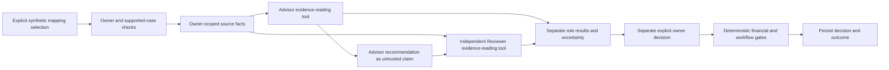

# Track B integration and release review — October 20, 2026

> Latest scoped verification: [Final evaluation readiness](EVALUATION-READINESS.md). It records the newer UX checkpoint, source/hash reuse, security applicability and current integration gate. The dated build/test evidence below remains unchanged.

**Local safety candidate: `ae8535acc71e78752b508ef57e597d9baaf426a7` (safety commit `bb85b2c` plus validated SDK pin). Production NO-GO.** This report is an evidence addendum; it neither changes approved scope nor certifies Track A. The original live evaluation and its exhausted four-call ledger remain unchanged. No new generation or countTokens calls occurred.

## Requirement → implementation → evidence

Statuses describe the actual evidence boundary. “Local validated” never means hosted/live/production validated. Every applicable capability remains in scope.

| Requirement | Actual implementation | Evidence and classification | Remaining gate |
| --- | --- | --- | --- |
| Select synthetic task; explicit invocation | Existing five-phase workspace and opt-in clearing-account panel | **Implemented + local validated**: actual browser journey; no call on render tests | Combined UX and hosted auth acceptance |
| Discovery/readiness | Discovery tools, deterministic assessment and source profile | **Implemented + deterministic validated**: full HTTP golden journey, blocked-readiness negative case | No claim that the readiness score is Gemini reasoning |
| Intelligent account mapping | Deterministic proposals, compatible targets, policy gates; optional mapping reasoning | **Implemented + deterministic/mocked validated**; one genuine ambiguous-clearing live case | Broader accountant-labeled accuracy remains **OPEN** |
| Exception explanation/recovery | Existing failure/retry flow; resolution reasoning projection and orchestration | **Implemented + deterministic/mocked validated**: migration failure, retry and fallback golden cases | Live per-capability quality is **UNTESTED** |
| Advisor with evidence, explanation and uncertainty | `reasoning.py`, projection/provider/ADK, separate analysis panel | **Implemented + local validated + one real recorded case** | Live application activation remains disabled |
| Independent Reviewer of recommendation | `analysis.py` → `reviewer.py`; fresh source projection, separate provider/session, Advisor claim explicitly untrusted | **Implemented + local validated + one real recorded case**: ACCEPT reasoning while CHALLENGED mapping | Same-model roles are not statistically independent; real disagreement not demonstrated |
| Agreement/disagreement | Separate outcomes and source facts; no aggregation into financial authority | **Implemented + mocked validated**: QUESTION/REJECT tests; live agreement only | Broader disagreement adjudication **OPEN** |
| Human accept/reject | Existing owner-approved mapping and plan routes; deterministic policy gates | **Implemented + local validated**: explicit approve/reject HTTP journey; browser rejection; one audit event; replay 409 | Hosted identity/account acceptance **BLOCKED** |
| Request clarification/source evidence | Decision-ready API/state-machine proposal; no persistence route or functional button | **MISSING / OPEN**, contract not approved | Owner chose combined integration validation first, contract review second; no scope deletion/waiver |
| Deterministic reconciliation | Existing migration, validation/configuration and exact financial checks | **Implemented + deterministic validated**: mismatch/repair, unsafe stage bypass and stale manifest cases | No external accounting writes or real-books certification |
| Contextual onboarding | Existing onboarding/FPU orchestration, prerequisite checks, optional guidance projection | **Implemented + deterministic/mocked validated**: prerequisite, failure/retry, verified synthetic FPU golden cases | Live onboarding model quality **UNTESTED** |
| Agent/tool contracts | Existing architecture; evidence-only model tool; strict structured outputs | **Implemented + mocked/recorded validated**: allowlist, malformed/injected assertions, tool-loop boundaries | Valid citations do not prove semantic truth |
| Offline Judge | Existing catalog/evaluator; malformed-output/trace robustness fixed | **Implemented + offline validated**: 18/18 expected decisions; 23/23 scripted scenarios | Scores are contract detection, not model accuracy |
| Model failure/unavailable fallback | Deterministic fallback preserves review and financial boundaries | **Implemented + mocked validated**: timeouts, service/schema/evidence errors, disabled mode | Hosted resilience/load/latency **OPEN** |
| Owner/workspace/mapping isolation | Backend admission, selected-fact citations, account-scoped request lifecycle across paired and older panels | **Implemented + local validated**: credential races, UID changes, stale responses, proxy and owner tests | Two approved hosted synthetic accounts **BLOCKED**, no hosted claim |
| Audit, traceability and replay | Session records, separate role/context IDs, human audit, request IDs, CAS and policy reservations | **Implemented + local validated**; browser audit and recorded transport IDs | Durable deployment/restart/concurrency acceptance **OPEN** |
| LOW/2048/no SDK retries | Existing production adapter serialization | **Implemented + mocked validated**, unchanged adapter; final exact-image import/config smoke passed | Separate activation approval |
| 50,000 input guard, exclusive four-attempt claim, $0.20 plan | Existing separately staged evaluation harness and persistent ledger | **HARNESS-ONLY validated historically**; consumed ledger, zero remaining | Do not transfer this authorization to UI/API. Application pre-call counted-token/cost policy needs review before activation |
| Complete usage, thinking and billable cost | Future adapter distinguishes missing usage; preserved raw evidence | **PARTIAL / UNVERIFIED**: known components reconciled, thinking missing | No invoice-level cost or reconstructed missing wire context |
| Complete refreshed UX integration | Gemini candidate isolated; Track A source inspected read-only | **BLOCKED** by unaccepted immutable UX checkpoint | Do not combine source worktrees prematurely |
| Hosted synthetic evaluation / production activation | No new hosted revision or live model invocation | **NOT RUN / BLOCKED** | Exact-artifact, identity, permission, scope, cost and deployment gates |

The five capability enum routes are planning, mapping, resolution, configuration and onboarding; discovery/readiness itself is deterministic. A route/projection existing is not proof that live Gemini has been evaluated for that capability. No generic chatbot, second agent framework, autonomous approval, external accounting connection or new financial feature was added.

## Fresh focused validation

- **161 unique backend tests passed**: the 160-test focused run plus the 12-test SDK configuration rerun (11 overlapping tests and one new pin regression); Python socket connect/DNS denied. Two warnings: existing Starlette/httpx deprecation and pytest assertion rewriting after importing the offline harness. Both are reported, not suppressed.
- **129 frontend tests passed** across seven files. TypeScript no-emit, affected-file ESLint, affected-file Ruff and whitespace checks passed.
- Offline Judge: **18/18** expected acceptance/rejection cases; scripted service evaluation: **23/23**. These are synthetic contract tests, not 100% financial/model accuracy.
- New tests cover malformed Judge JSON/reference/trace inputs; optional-panel sign-out/UID/workspace/mapping races; duplicate in-flight requests; uncertain retry identity; delayed credentials; initialization failure; same-UID refresh; old finalizers; timeout sanitization; paired analysis followed by independent human approve/reject and final-decision replay.
- Existing selected tests cover source evidence gaps/conflicts, Reviewer disagreement, unsafe claims, empty evidence, disabled providers, tool/call reservations, quota corruption/outages/concurrency, cross-owner admission, reconciliation mismatches, retry and stage-bypass controls. A valid reference accompanying an unsupported accounting claim remains an explicit semantic-limit test, not a passed accuracy assertion.

Logs: `evidence/track-b/backend-final.txt`, `frontend-validated.txt`, `typescript-final.txt`, `eslint-final.txt`, `ruff.txt`, `judge-report.json`, `offline-agent-report.json`. Initial failed test receipts are retained: one test injected Settings through the wrong seam (fixed to the route's actual settings function); one old UI assertion expected the planned badge in an active opt-in preview (updated to require the exact preview distinction). No acceptance control was removed.

## Actual browser journey and preview

Local preview: **http://localhost:3321/workspace**, isolated API loopback 8321. Demo identity and in-memory synthetic data only; outgoing API socket/DNS connections denied. Model mode is `deterministic-only`, synthetic analysis enabled locally, live beta authorization false. The existing public shell is from the Gemini source, **not the refreshed Track A acceptance candidate**; its historical header/copy must not be used as evidence of production activation.

Observed sequence: enter demo → Harbor Light → explicit readiness → create plan → review `1200 · Misc Clearing` → explicit paired analysis → inspect separate role source references/uncertainty → explicit test-actor rejection → inspect exactly one recorded `demo-user` decision. Both role calls report zero model calls; mapping is REJECTED, financial execution is null and Move remains held. Switching to the next mapping removed the prior role panel. Approve-path/replay behavior is covered separately by HTTP tests; the browser did not approve the ambiguous mapping.

Evidence: `evidence/track-b/browser-journey.json`, `reviewer-visible.png`, `human-decision.png`, AX snapshots and local server logs. Browser checks demonstrate the observed viewport, accessible labels/disclosures, Tab focus into contextual help and Enter expansion (`keyboard-focus-ax.txt`, `keyboard-disclosure-ax.txt`); no mobile-device, comprehensive accessibility audit, real Firebase account-switch or combined UX acceptance is claimed. Local state is ephemeral and may disappear when the preview stops. The complete five-phase deterministic HTTP journey passes; the browser exception journey intentionally stops at its unresolved/rejected mapping.

## Preserved genuine inference and cost limits

All **63 original artifacts** match their prior manifest. The live bundle SHA-256 is `b87d0537e5b74203236b66b63379f263a062d4f756cc2b5b5679f69363f313f7`; all four embedded original-file hashes and the ledger snapshot hash match. Receipt: `evidence/track-b/evidence-integrity.json`. No real ledger access was needed.

Recorded real execution: October 20, 2026, 11:48:40–11:48:49 UTC; project `movebooks-ai`; independently verified ADC `jeasom@gmail.com`; `gemini-3.5-flash-lite`, global `https://aiplatform.googleapis.com`; returned version matches model ID, no finer revision exposed. Four attempts consumed, **zero remain**. Advisor escalated the missing account purpose; independent Reviewer supported investigation while challenging mapping evidence. No financial state changed.

Reported input **5,207**, candidate output **557**; historical rate calculation **$0.0029546**. This is a reported-component estimate, **not complete billable cost**. Thinking tokens are missing for all four transport responses. `countTokens` totaled **4,382**, a difference of **825** from response input usage; per-call differences 197/205/206/217 remain unexplained because the full original wire context is absent. Do not fill this gap with an estimate disguised as measured usage. Transport latency sum **4,580 ms** is not end-to-end latency; Advisor application latency was 6,303 ms and Reviewer application latency was not retained. Historical planning bound $0.08048 under the four-call assumptions is not a billing hard cap or permission for another run.

## Unofficial AI Builder Cup estimate

The [official rubric](https://aibuildercup.com/themes.html) provides the weights, not the scores below. These ranges are **subjective, unofficial estimates of the present evidence**, not an award prediction, benchmark or measured product-quality score. October 20 post-submission work must be presented as a dated addendum if submission rules permit it.

| Category | Weight | Unofficial contribution estimate | Strong evidence / gap |
| --- | ---: | ---: | --- |
| Technical Merit & GenAI Implementation | 40 | 28–32 | Real Vertex/ADK tool loop, separate roles, owner controls, recorded traces and negative tests; gaps in live application activation, complete usage, runtime release gates and semantic coverage |
| Problem Alignment & Impact | 25 | 16–19 | Concrete ambiguous accounting case and human decision boundary; no measured customer savings, accountant-adjudicated broad accuracy or user study |
| Innovation & Creativity | 25 | 16–19 | Reviewer agreement can coexist with challenged mapping; independent evidence and deterministic financial controls; no comparative novelty benchmark, durable clarification workflow missing |
| User Experience & Solution Design | 10 | 5–7 | Real explicit local journey with provenance, uncertainty and human audit; refreshed/hosted/mobile/a11y acceptance incomplete |
| **Total** | **100** | **65–77** | Missing capabilities and release gates prevent a stronger defensible evidence claim |

Interview-relevant decisions: use an unresolved outcome when purpose is missing; distinguish a claim from its evidence; keep model agreement separate from financial approval; reserve call budgets before requests; keep unknown thinking cost unknown; use server ownership/CAS rather than UI trust; bind tests/builds to immutable source; clear private results on identity change even without parent remount. Explain these tradeoffs with the actual traces and tests, not invented ROI or confidence percentages.

## Integration contract and collision boundary

Existing paired route: `POST /v1/migration-sessions/{session_id}/analysis/mapping/{mapping_id}` with `{request_id: UUID, confirmed: true}`. Identity comes only from verified authentication. Preserve the generated schema, role linkage, source mapping references, `human_approval_required: true`, `financial_authority: false`, missing evidence/uncertainty, safe loading/error/unavailable states, and independent approve/reject routes. `HANDOFF.md` and `analysis-api-schema.json` remain the authoritative API details; no backend schema change in this commit.

New frontend dependency: `lib/use-advisory-request.ts`, consumed by `ReasoningAdvice.tsx` and `IndependentReview.tsx`; retain their identity lifecycle as well as the paired component's existing protection. `MappingReview.tsx` has one conditional status-copy change. Request Source Evidence is not a working action. Any later evidence contract must be reviewed after combined validation, per owner sequencing.

Track A branch `feature/v2-landing-final`, commit `3e55d8871175ae9dd31e14c14143352da40b0625`, had eight later modified tracked files at initial inspection, increasing to fourteen during independent Track A work. At final readback, its authoritative owner-scope matrix reports both provider marks and exact copy locally implemented, positioning verified and **BRANDING FROZEN**. Public-use/qualifying-use evidence, hosted identity/isolation, final committed artifact and other release gates remain blocked. Its old text-only branding PASS is historical; the new local branding PASS also is not final release acceptance. No accepted immutable updated UX checkpoint is available. Track B does not modify that branch, its working files, image tags, running preview or shared cloud configuration. Only distinct loopback ports and uniquely tagged local images are used. No integration branch is created while the source acceptance gate is incomplete.

## OPEN scope, critical path and owner decisions

No row below is deferred out of scope. Estimates are engineering effort after its input decisions/access are available; wait time is additional.

| Order | OPEN work | Effort estimate / dependency |
| --- | --- | --- |
| 1 | Accepted immutable Track A checkpoint, including its locked provider treatment and owner gates | External owner/Track A dependency; no reliable completion date supplied |
| 2 | Isolated combined-tree reconciliation, actual full journey, desktop/mobile/keyboard/accessibility and stale-account acceptance | 4–8 hours after accepted UX source; existing conditional integration authorization retained |
| 3 | Review durable evidence request permissions, retention, hold and stale-context contract | 1–2 hours of owner/product/accounting decision time; owner explicitly selected this after step 2 |
| 4 | Implement approved evidence lifecycle with persistence/CAS/audit and negative/restart/concurrency tests | 2–4 engineering days after contract approval; no partial working button before backend completion |
| 5 | Application counted-input/cost policy, durable admission/kill-switch acceptance, model usage and observability completion | 1–2 engineering days plus separately authorized hosted/live validation; exhausted ledger never reused |
| 6 | Accountant-labeled broader synthetic cases and quality acceptance; no unsupported accuracy claim | 1–2 days engineering/test setup plus accountant time and fresh inference authorization if required |
| 7 | Final combined image/SBOM/scan, approved synthetic accounts, hosted isolation and rollback/monitoring acceptance | 1–2 days after source/security/auth inputs and separate publication/deployment approval |

Conditional critical path for the **full retained scope** is approximately **6–10 engineering days after the accepted UX checkpoint and prompt contract decisions**, allowing independent quality/operational work to overlap. Combined local integration alone is 4–8 hours. An exact calendar launch ETA cannot be established while owner/UX/account/security/authorization dependencies have no dates. Earlier estimates that excluded the evidence workflow are not full-scope estimates.

## Consolidated release approval packet — not an activation request yet

The release operator must bind one reviewed combined source SHA, API/web configuration and registry digests, fresh SBOM/scan results, required existing IAM/model permission readbacks, exact target services/revisions/domains and rollout/rollback checks in **one** approval request. Current standalone source is not an accepted combined release. Keep both analysis flags off in ordinary production and preserve the Settings rejection of live reasoning in staging/production; do not bypass it to make a demo work. Any approved live synthetic environment needs explicit project/model/global processing, authenticated synthetic owners, counted-token and monetary reservation policy, owner/global limits, sanitized usage/latency telemetry and a verified kill switch.

Rollback preparation: record the then-current known-good API/web digests, environment and traffic before any write; switch off model policy/feature exposure first if a safety/cost condition triggers, retain audit/usage records, then restore approved revisions/traffic under the deployment plan. Never “roll back” by resetting authorization ledgers or deleting financial/audit history. Alerts must cover admission failures, unexpected model attempts, missing usage/thinking data, token caps, cumulative reservation/spend, role failure rate and latency. Do not refund uncertain calls on timeout.

**Smallest next owner action:** close Track A's already documented acceptance blockers and identify its accepted immutable checkpoint. Combined local validation then proceeds before the source-evidence contract review, as requested. Production deployment/live activation is **NO-GO**; no request to approve an unspecified deployment or waive an OPEN requirement is made.

## IAM/model permission evidence boundary

The immutable pre-execution receipt contains a fresh **11:47:46–11:48:00 UTC October 20** check for approved `jeasom@gmail.com` ADC, matching project/quota `movebooks-ai`, active project, billing, Vertex API, authenticated model metadata, and `aiplatform.endpoints.predict` plus `serviceusage.services.use`. The receipt independently checks ADC; CLI identity alone was not accepted. Its cloud-only section correctly leaves harness readiness unverified; the enclosing pre-execution record separately verifies the source, pins, guards and ledger and records PRECONDITIONS PASS.

These checks are **historical PASS for that evaluation principal**, not current production service-account permission or quota proof. No auth refresh/IAM inspection was repeated here. The intended deployed service principal and final synthetic environment must have read-only permission/model/kill-switch verification at its own execution gate. No IAM/API-enablement/provisioning request is bundled implicitly with deployment approval.

## Exact Gemini changes and source reproducibility

Two local commits: `bb85b2c36b6bb92643a389826d31e48d7e68fb50` (safety, UI provenance and tests) and `ae8535acc71e78752b508ef57e597d9baaf426a7` (validated model-SDK pin). Final candidate is the second SHA. No push or merge. Fourteen distinct committed paths relative to `ea0e3f0`:

- `apps/web/components/plan-map-approve/AssistedAnalysis.test.tsx`
- `apps/web/components/plan-map-approve/IndependentReview.test.tsx`
- `apps/web/components/plan-map-approve/IndependentReview.tsx`
- `apps/web/components/plan-map-approve/MappingReview.tsx`
- `apps/web/components/public-surfaces/ReasoningAdvice.test.tsx`
- `apps/web/components/public-surfaces/ReasoningAdvice.tsx`
- `apps/web/lib/use-advisory-request.test.ts`
- `apps/web/lib/use-advisory-request.ts`
- `docs/gemini-advisor-v2/TRACK-B-IMPLEMENTATION.md`
- `pyproject.toml`
- `scripts/agent_quality_judge.py`
- `tests/test_agent_quality_judge.py`
- `tests/test_gemini_human_journey.py`
- `tests/test_reasoning_configuration.py`

This release report and dated-history notices in `HANDOFF.md`, `PRODUCT-READINESS.md` and `AI-BUILDER-EVIDENCE.md` form a separate documentation-only follow-up. Raw receipts/screenshots and all original evaluation artifacts remain untracked and unchanged; no broad `git add` was used. The final Git receipt records the documentation HEAD and verifies no runtime change from `ae8535a`. The first image attempt was stopped after discovering transitive `google-genai 2.31.0`; it is not accepted evidence for the final candidate. The final candidate pins `google-adk 1.39.1` and `google-genai 2.28.0`. Other API dependencies still have declared ranges: an exact source commit alone does not guarantee reproducible resolution. The actual image SBOM/configuration digest identifies its resolved environment; complete dependency locking remains OPEN before a reproducible release claim.

## Technical demo sequence

For the local preview, A and R use deterministic fallback; the genuine model/tool trace is the separately labeled October 20 recording. No model→financial-write edge exists. The durable clarification-request edge is deliberately absent because that required workflow is still OPEN, not because it was removed from scope.

## Fresh dependency security audit

The exact frontend lockfile's read-only `npm audit --json` returned **five High entries, zero Critical**, all propagated from **GHSA-vfj7-8cjw-p6xm** (`braces` stack-exhaustion denial of service) through `micromatch`, `fast-glob`, `@next/eslint-plugin-next` and the direct `eslint-config-next` development dependency. Evidence: `evidence/track-b/npm-audit.json`. This is one underlying advisory reported across five affected dependency nodes, not five independently established exploit paths.

The offered npm resolution changes `eslint-config-next` to major version 14.2.35; it was not automatically applied to the Next 15 project or treated as a safe compatible fix. **Security gate remains BLOCKED** pending a supported remediation with regression checks or an explicit security-owner disposition. A clean runtime-image scan would not waive this development/build-chain finding. No advisory suppression, automatic major downgrade or test weakening was performed.

Machine-readable approval preparation: `evidence/track-b/release-approval-packet.json`. Unaccepted combined source, target services/revisions, registry digests, rollout percentage and current rollback digests deliberately remain null; the packet is BLOCKED_NOT_SUBMITTED. Approving this document alone must not be interpreted as permission to fill those fields or perform cloud writes.

## Built image, SBOM and offline runtime evidence

Durable artifact directory: `/Users/jincenmathew/Downloads/Intuit/movebooks-track-b-release/ae8535a-20261020`. Its 38 retained files total **296,723,611 bytes** before the manifest itself. `MANIFEST.json` SHA-256: `3d053472cb241bec1ae9bb9fae4a4b137daf8374a63c777a879d13d2f10ae65b`. Every copied file matched its original checksum.

Both unpublished `linux/amd64` images were built from the exact **375 committed runtime files** at `ae8535acc71e78752b508ef57e597d9baaf426a7`; source archive SHA-256 `b344f2514ea9b6e87d809d44840f46555756d2a2d922330df6f2e3ad1b053700`. No untracked evaluation data, ADC files or ledger entered the context. Build configuration contains the existing public Firebase client configuration, not server credentials. Docker authentication configuration is excluded from the artifact packet.

| Artifact | API | Web |
| --- | --- | --- |
| Local tag | `movebooks-trackb-api:ae8535a-local` | `movebooks-trackb-web:ae8535a-local` |
| Docker-reported image/index identity | `sha256:8cf6636e5e3748485e39d167bd77cb6337591dff6bd97990009feca822b0789e` | `sha256:54101672c5d6ff524e4659013868497393411410182f26633d12021d7b636953` |
| Configuration digest verified against scan | `sha256:0f68f8e5c2f19e91cdf7b1f80d58b4f4a5b6ac0a5314b12f7b60bf970498c54d` | `sha256:2e144f1f1223f5deaac8028844eafad030f84c81f39962df2f6caec85ddccf2d` |
| Export archive bytes | 203,978,240 | 81,083,392 |
| Export archive SHA-256 | `8a0a26c07860006768e6a8880eb605a98e90a3b0ffcf512b70924d3744b7bf14` | `160b27ccf62dcd009b75aa7a05246770313368b0fe9b4047b8353a6e529b32b2` |
| CycloneDX components | 2,258 | 519 |
| Grype matches | 14 Medium, 3 Low, 14 Unknown; zero High/Critical | Zero matches |
| Runtime smoke | PASS | PASS |
| Image security disposition | REVIEW REQUIRED | No matches at this scan time; not an overall release PASS |

Scanners are pinned by digest in `security-results.json`; Syft 1.55.0 and the recorded Grype version use the existing cached database, with network disabled and updates disabled. Database status is valid, built October 20 at 06:29:49 UTC, approximately 10.95 hours old at scanning. No ignored matches were accepted. Image archive hashes were verified before and after scanning and Grype's configuration identity matched the exported image. Findings are package/advisory matches, not necessarily distinct vulnerabilities or proven exploitability; Unknown is not a low-risk classification.

API findings include Python and glibc base-package advisories, with fixes reported for several matches. Supported base-image remediation and disposition of remaining findings are **OPEN**, alongside the development-chain High advisory. No severity suppression, base-image substitution or waiver was performed. These images are review artifacts for the standalone Gemini candidate, not the unbuilt combined UX release.

Both smoke containers run without external networking, with read-only roots, dropped capabilities and unprivileged application UID 65532. The API image imports real ADK 1.39.1/GenAI 2.28.0 on Python 3.14.8, checks schema identity, LOW/2048 and disabled defaults, then exercises the synthetic HTTP mapping/paired-fallback journey: zero model calls, zero decisions, no financial execution, unauthenticated access denied. The web image starts its standalone server and serves the real sign-in page; no Google sign-in is performed. AMD64 emulation on the local ARM host is not native Cloud Run, hosted account-isolation or production acceptance.

Two initial scanner attempts could not see the host archives because the existing VM mounts only its designated temporary folder. Their logs are preserved. Verified copies were placed in a new isolated subdirectory of that already mounted folder; no VM configuration or prior evidence changed. The scanner wrapper now returns failure for blocked SBOM/scan results. Build, scan, smoke scripts and logs are retained with the manifests. No registry publication occurred.
