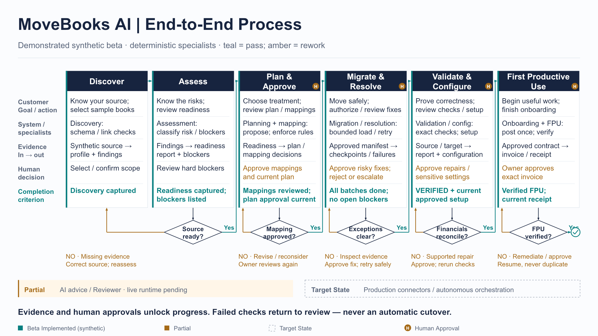
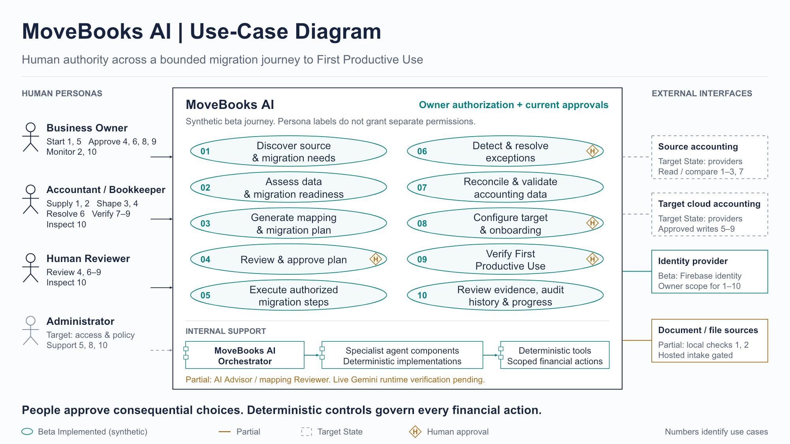
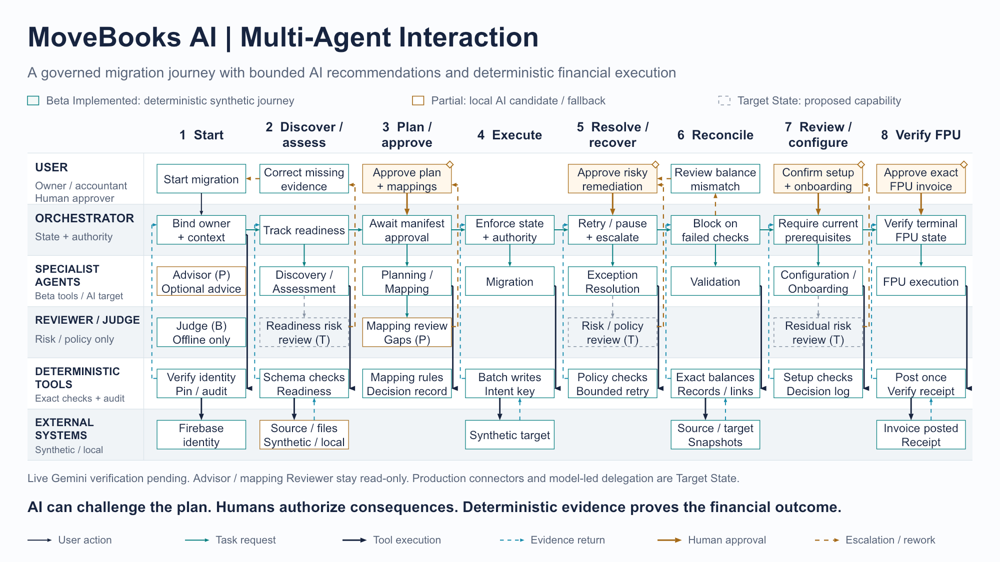
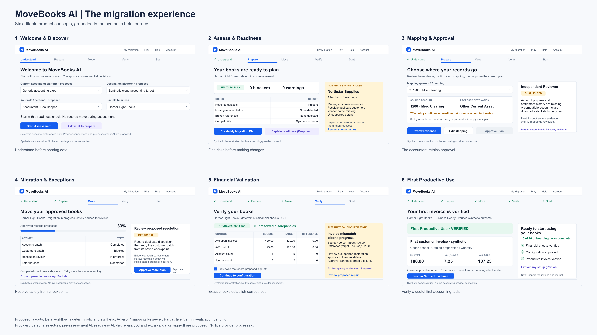
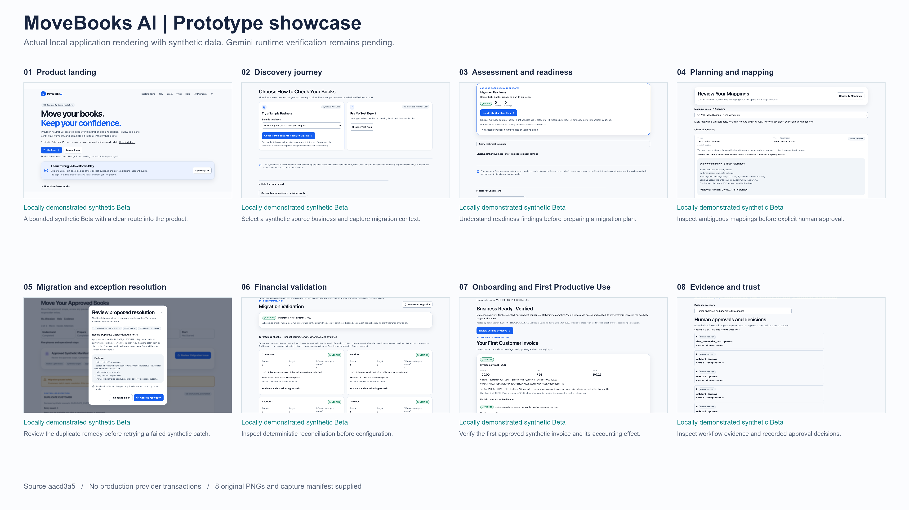
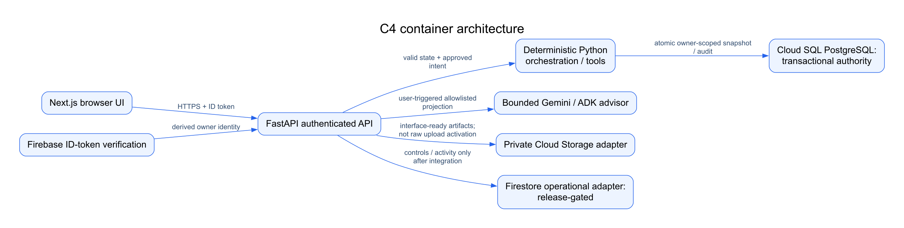
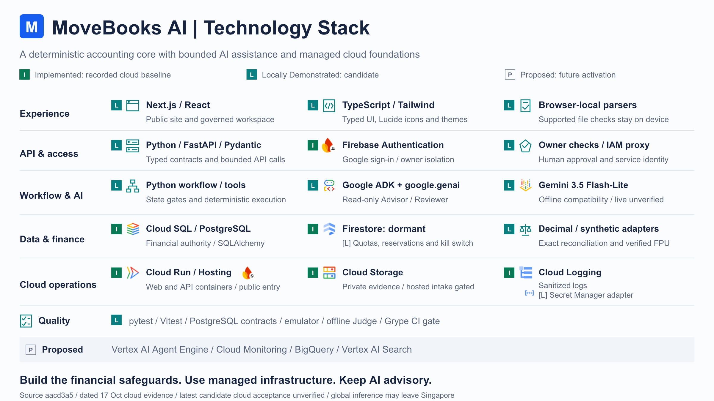
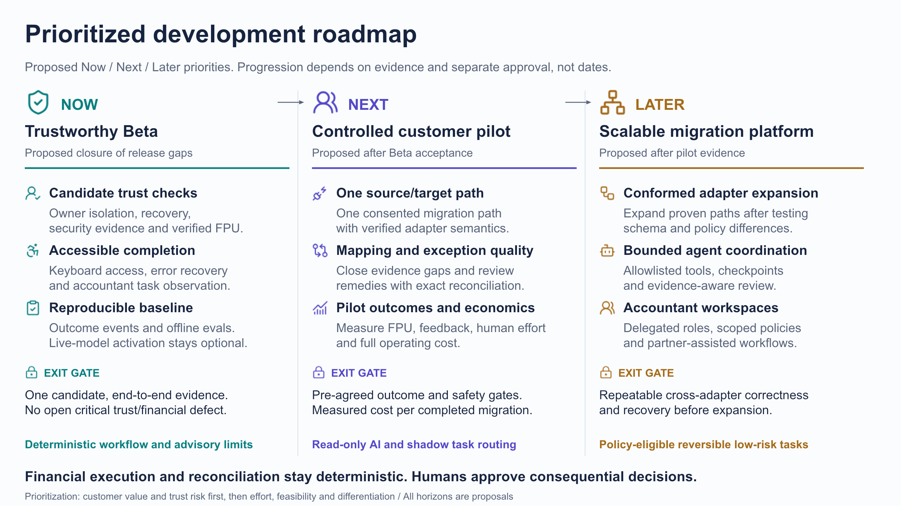

# Product Showcase

[Launch the product](https://movebooks-si.web.app) · [Watch the hosted demo](https://movebooks-si.web.app/learn?tab=videos#lesson-09) · [Capability evidence](EVIDENCE.md) · [Repository overview](../../README.md)

Eight product and technical artifacts explain the customer journey, authority model and platform.
The original design exports below are **18 October 2026 snapshots**. Their embedded “live Gemini
pending” and dormant-service labels remain historical; consult the [25 October acceptance status](EVIDENCE.md)
for accepted production Gemini behavior and its evidence limits. No design image establishes deployment.

**Publication manifest:** [file hashes, origin and source status](manifest.json). Seven original
PPTX/PNG pairs are preserved byte-for-byte; architecture reuses the repository's existing C4 source
and export. The original 24-file refresh is published in PR #40; this evidence update requires owner approval before pushing.

Open each PNG at full size for small labels; the wireframe and prototype overviews are navigation
sheets. Their editable decks provide individual readable slides. Screenshots within the prototype
deck remain pixels; titles and captions are editable.

| Artifact | Evidence class | Editable source |
| --- | --- | --- |
| 01 — [End-to-end process](#01-end-to-end-process) | C — locally demonstrated synthetic process | [PowerPoint](assets/01-process.pptx) |
| 02 — [Use-case diagram](#02-use-case-diagram) | C — synthetic implementation; D — target personas/connectors | [PowerPoint](assets/02-use-cases.pptx) |
| 03 — [Multi-agent swimlane](#03-multi-agent-swimlane) | C — deterministic roles; D — model-led delegation | [PowerPoint](assets/03-swimlane.pptx) |
| 04 — [Solution wireframes](#04-solution-wireframes) | D — proposed layouts, grounded in C — synthetic behavior | [PowerPoint](assets/04-wireframes.pptx) |
| 05 — [Prototype showcase](#05-prototype-showcase) | C — genuine local UI, synthetic records | [PowerPoint](assets/05-prototype.pptx) |
| 06 — [Solution architecture](#06-solution-architecture) | C — source architecture; historical deployment boundaries | [Mermaid](../architecture-experience/source/c4-container.mmd) · [SVG](../architecture-experience/svg/c4-container.svg) |
| 07 — [Technology stack](#07-technology-stack) | Historical implementation snapshot; D — explicitly proposed services | [PowerPoint](assets/07-technology.pptx) |
| 08 — [Future development roadmap](#08-future-development-roadmap) | D — planned; no delivery-date commitment | [PowerPoint](assets/08-roadmap.pptx) |

## 01 End-to-end process

**Status: C — locally demonstrated synthetic process.** Shows readiness, approvals, migration, reconciliation and first use, including the return paths when checks fail.

**User benefit:** Know what must be true before the next step can proceed.

**Product / platform relevance:** Defines a completion contract and measurable handoffs across a long customer journey.

[Full-size preview](assets/01-process.png) · [Original editable PowerPoint](assets/01-process.pptx). Revision: original export, 18 October 2026; source workstream inspected at `aacd3a5`. These asset files were untracked in that worktree, so the commit is context, not proof that the bytes were committed; hashes identify the exact originals.

## 02 Use-case diagram

**Status: C — synthetic implementation; D — target personas/connectors.** Maps business owners, accountants, human reviewers and external interfaces to migration tasks. Persona labels are not an implemented delegated-permissions model.

**User benefit:** Understand who supplies evidence and who authorizes a decision.

**Product / platform relevance:** Separates customer jobs, authority boundaries and future integrations from implementation detail.

[Full-size preview](assets/02-use-cases.png) · [Original editable PowerPoint](assets/02-use-cases.pptx). Revision: original export, 18 October 2026; source workstream inspected at `aacd3a5`. These asset files were untracked in that worktree, so the commit is context, not proof that the bytes were committed; hashes identify the exact originals.

## 03 Multi-agent swimlane

**Status: C — deterministic roles; D — model-led delegation.** Distinguishes the user, orchestrator, specialists, Reviewer/Judge and deterministic tools. Not every labelled agent is a model runtime; internal Judges are offline evaluators.

**User benefit:** See why an AI recommendation cannot move money or approve itself.

**Product / platform relevance:** Makes orchestration, escalation, independent review and tool authority explicit.

[Full-size preview](assets/03-swimlane.png) · [Original editable PowerPoint](assets/03-swimlane.pptx). Revision: original export, 18 October 2026; source workstream inspected at `aacd3a5`. These asset files were untracked in that worktree, so the commit is context, not proof that the bytes were committed; hashes identify the exact originals.

## 04 Solution wireframes

**Status: D — proposed layouts, grounded in C — synthetic behavior.** Six editable layouts explore discovery, readiness, mapping, exceptions, verification and first use. These are mockups, not product screenshots.

**User benefit:** Makes the current task, evidence and approval understandable at each stage.

**Product / platform relevance:** Connects interaction design to decision rights and financial safeguards without claiming release.

[Full-size preview](assets/04-wireframes.png) · [Original editable PowerPoint](assets/04-wireframes.pptx). Revision: original export, 18 October 2026; source workstream inspected at `aacd3a5`. These asset files were untracked in that worktree, so the commit is context, not proof that the bytes were committed; hashes identify the exact originals.

## 05 Prototype showcase

**Status: C — genuine local UI, synthetic records.** Eight authentic local screenshots cover landing, discovery, readiness, mapping, recovery, validation, FPU and evidence. Source inspection was at aacd3a5 on 18 October; exact dev-server binary equivalence was not independently attested.

**User benefit:** See real implemented screens and the evidence behind an approved synthetic invoice.

**Product / platform relevance:** Demonstrates an integrated outcome while retaining capture and environment provenance.

[Full-size preview](assets/05-prototype.png) · [Original editable PowerPoint](assets/05-prototype.pptx). Revision: original export, 18 October 2026; source workstream inspected at `aacd3a5`. These asset files were untracked in that worktree, so the commit is context, not proof that the bytes were committed; hashes identify the exact originals.

### Dated public production screenshots

Actual signed-out guided demo, **sample evidence**, 24 October 2026 IST. It performs no migration
and grants no approval. [24 October landing capture](assets/product-public-20261024.jpg) is also genuine,
but its laptop illustration and 25-second film are conceptual marketing media, not an operational
workspace. [24 October Academy capture](assets/academy-public-20261024.jpg) shows published lessons.
All three are unaltered 1280 × 720 browser captures at the canonical public site, with no account
identity, private session or model request. The 18 October prototype deck shows a different local
implementation and must not be relabelled as today's production screenshots.

### Accepted production Gemini result — 25 October 2026

The owner verified the existing saved Advisor explanation and independent Reviewer **QUESTION**
assessment in production, with grounding, uncertainty and “Historical analysis restored. No model
was called.” [Four-P0 receipt and evidence attribution](EVIDENCE.md#four-p0-acceptance).
The authenticated screenshots remain owner-held and are not embedded here. The public captures
above and the local prototype deck are not substitutes for that acceptance evidence.

## 06 Solution architecture

**Status: C — source architecture; historical deployment boundaries.** Reuses the existing C4 container diagram and editable Mermaid/SVG. It distinguishes the authenticated API, deterministic workflow, transactional state, bounded advice and gated operational adapters. It is a logical view, not a current deployment inventory.

**User benefit:** Keep financial state and authority separate from optional explanations.

**Product / platform relevance:** Explains platform boundaries, protected state and the difference between adapters and activated services.

[Editable Mermaid](../architecture-experience/source/c4-container.mmd) · [Editable SVG](../architecture-experience/svg/c4-container.svg) · [Architecture catalogue](../architecture-experience/README.md). Revision: architecture catalogue v1, 17 October 2026, baseline `8f750d9`; reused from main `54f1b3f`.

## 07 Technology stack

**Status: Historical implementation snapshot; D — explicitly proposed services.** Groups the UI, API, identity, accounting core, optional reasoning, managed infrastructure and quality checks. The original cloud evidence is dated 17 October; its Gemini and Firestore labels are historical.

**User benefit:** Understand the technology behind reliable workflow, identity and explainable decisions.

**Product / platform relevance:** Shows build-versus-managed choices and the evidence required before claiming a service is operational.

[Full-size preview](assets/07-technology.png) · [Original editable PowerPoint](assets/07-technology.pptx). Revision: original export, 18 October 2026; source workstream inspected at `aacd3a5`. These asset files were untracked in that worktree, so the commit is context, not proof that the bytes were committed; hashes identify the exact originals.

## 08 Future development roadmap

**Status: D — planned; no delivery-date commitment.** A Now / Next / Later proposal progresses from trustworthy Beta through a controlled pilot to a broader migration platform. Current status must be read separately.

**User benefit:** Sets expectations for improvements without presenting a future connector as available.

**Product / platform relevance:** Uses outcome, safety and economic gates to sequence investment and expansion.

[Full-size preview](assets/08-roadmap.png) · [Original editable PowerPoint](assets/08-roadmap.pptx). Revision: original export, 18 October 2026; source workstream inspected at `aacd3a5`. These asset files were untracked in that worktree, so the commit is context, not proof that the bytes were committed; hashes identify the exact originals.

## Provenance and exclusions

The requested `movebooks-github-artifacts` directory and a separately named “Screenshots of
Submission Package” collection were not found in the inspected Intuit folders. Equivalent original
submission decks, previews and a genuine prototype screenshot set were found locally and used.
The original architecture deck contains infrastructure-specific identifiers; this candidate uses the
existing public C4 equivalent instead. No raw release receipt or private Gemini proof package is included.

The asset archive remains **My Drive / MoveBooks AI/ EMOS**. Drive access and its revision parity
were not verified; no Drive URL has been invented and no archive file was modified.

Attribution remains Movers & Ledgers / MoveBooks AI. Provider marks identify referenced technologies,
not affiliation or endorsement. Original source assets and existing repository licensing remain authoritative.
