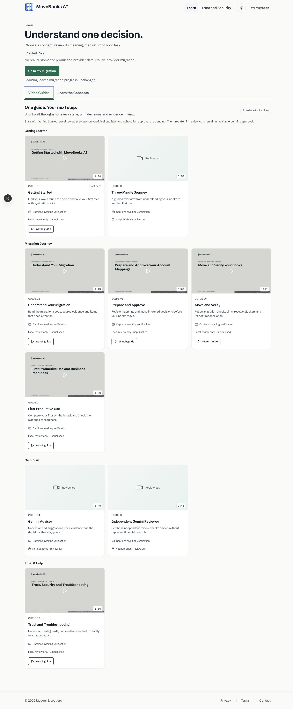
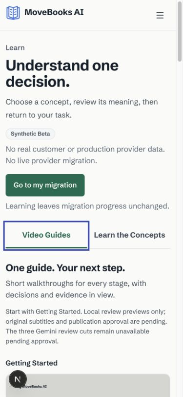
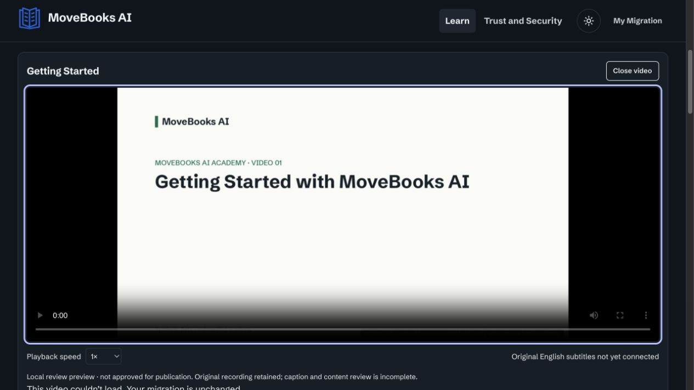
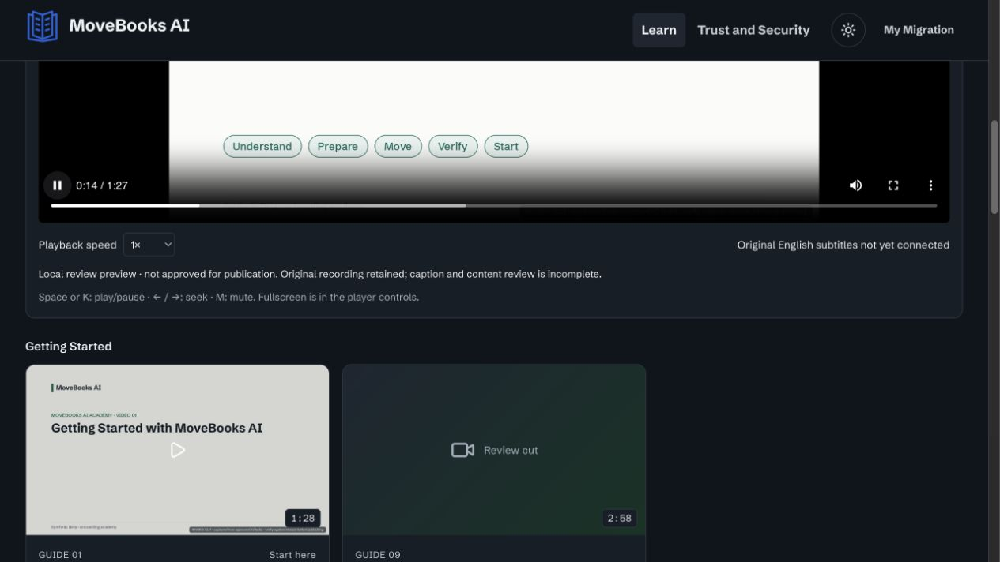

# Track C final acceptance — 23 October 2026

**NO-GO for production handoff. Implementation remains partial.** Six original MP4s genuinely play locally, but captions are absent, Cillian identity is not certified, and no production media is configured or approved.

Subsequent media-route correction: [release coordination](RELEASE-COORDINATION.md). The historical matrix below remains scoped to the original acceptance run; current production serving supports explicitly approved bundles, while all current original assets remain unpublished.

Live preview: http://127.0.0.1:3107/learn?tab=videos

Repository: `JEMathew/movers-and-ledgers`. Isolated worktree: `/Users/jincenmathew/Downloads/Intuit/movebooks-video-academy`. Branch: `feature/video-academy-v1`. Audited starting HEAD and live GitHub branch were both `69c0c68313e56bcc6630f1a79db526e2038dd9fc`. The delivered acceptance commit adds this evidence and the one-line help correction; its SHA is reported in the delivery response. No other worktree, production, IAM, financial or Gemini behavior was changed.

Only demonstrated defect fixed: player help no longer advertises caption controls when a caption track is absent. Approved grouping, layout and copy remain intact.

PASS means the stated check was executed with the stated limits. NOT VERIFIED is not PASS. FAIL identifies an unmet acceptance requirement. No missing evidence has been replaced by a claim of success.

| Check | Result | Evidence and limits |
|---|---|---|
| Repository, worktree and branch isolation | **PASS** | JEMathew/movers-and-ledgers; movebooks-video-academy; feature/video-academy-v1. Initial HEAD and live remote both 69c0c68313e56bcc6630f1a79db526e2038dd9fc. Other worktrees were only listed, never modified. Evidence: `scope-audit.json`. |
| All Track C changes reviewed; protected behavior unchanged | **PASS** | 48 files at the audited HEAD. Academy UI/media, additive WatchGuide links, focused tests, preparation script and evidence only. No financial, identity, Gemini, release, landing source or asset changes. One player-help copy defect fixed. Evidence: `changed-files.txt; preservation.json`. |
| Nine tiles, metadata, posters and labels | **PASS** | All expected titles and rounded runtimes match original assets. Six real posters loaded at 960px; three unavailable slots. Actual grouped order: 01,09 / 02,03,06,07 / 04,05 / 08, preserving approved four collections rather than global numerical order. Six accurately labeled local review only. Evidence: `tiles.json`. |
| Six original MP4 Play, pause and resume | **PASS** | Native Play clicked for all six. Time advanced, stayed fixed while paused, then advanced after resume. Original AAC audio enabled. This is not a voice-identity or audible-output certification. Evidence: `playback.json`. |
| Six keyboard seek, mute/unmute and speed controls | **PASS** | Each player accepted seek, mute/unmute and 2x speed; 1.5x also exercised on 07. Evidence: `controls.json`. |
| Adjustable volume level on all six | **NOT VERIFIED** | Native volume slider was operated on 07, but numeric volume was not exposed by the browser inspection bridge; full range and all six volume controls were not independently verified. Evidence: `fullscreen-07.jpg`. |
| Fullscreen entry and exit on all six | **NOT VERIFIED** | Native entry/exit verified for 01 and 07, including restored inline page and normal tab interaction. The remaining four are not marked PASS after an unreliable automated continuation. Evidence: `fullscreen.json; fullscreen-07.jpg; fullscreen-exited-07.jpg`. |
| Loading, playback error and retry | **PASS** | Loading messages observed during original media loads. A temporary readonly localhost proxy returned 503 for lesson 01 MP4. Actual player error UI appeared; restoring upstream and clicking Retry removed the alert and resumed time progression. Original files untouched; test proxy stopped. Shared component tested, not a separate outage for every lesson. Evidence: `fault-recovery.json; playback-error.jpg; playback-recovered.jpg`. |
| Integrity and full file decode | **PASS** | Nine source SHA-256 values still match the prior full FFmpeg decode evidence. All H.264 1920x1080/AAC stereo 48kHz, non-silent audio; six preview copies unchanged. Evidence: `preservation.json; ../media-review/playback.json; ../../media-manifest.json`. |
| Clean seek-to-end completion | **PASS** | All six reached ended=true at duration with error=null. This is seek-to-end validation, not six uninterrupted browser viewings. Lesson 07 also naturally reached its end after pause/resume; prior browser evidence has 03 completion. Evidence: `end-state.json; playback.json`. |
| Six uninterrupted browser playback completions | **PASS** | All six originals played from zero to ended=true at 2×, muted to prevent overlapping audio, with error=null and no seeks/pauses. This does not certify human listening or narrator identity. Evidence: `uninterrupted-playback.json`. |
| Audible Cillian narration identity | **NOT VERIFIED** | Original non-silent AAC audio is present and enabled, but this tool session cannot certify speaker identity or human-audited audibility. No narrator was regenerated. Evidence: `../../media-manifest.json`. |
| Six English caption sets, rendering and synchronization | **FAIL** | Original SRT files still inaccessible; no SRT/VTT in the authorized media directory. All six real browser players have zero caption tracks. Missing captions return 404. No synchronization or rendered-caption PASS is claimed. Evidence: `playback.json; http.json`. |
| Review-cut public-route restrictions | **PASS** | 04/05/09 MP4, poster and VTT paths return 404 in development. A localhost production build denied all 27 media paths even with review env flags set. No restricted file is in the serving directory. Evidence: `http.json; production-boundary.json`. |
| Both tabs, keyboard tabs and exact ten concepts | **PASS** | Original baseline titles, full body text and questions matched live DOM for all ten. Accordion expansion persists across tab switches. Switching to Concepts removes video. Arrow-key tab switching works. Evidence: `concept-preservation.json; desktop-concepts.jpg; mobile-concepts.jpg`. |
| Contextual video help | **PASS** | Real /assess Watch guide navigated to /learn?tab=videos&stage=0#lesson-02. No migration initiated or advanced. Explore Demo retains Watch guide to 01. All stage mappings and restricted link omission reviewed/tested. Evidence: `contextual-assess.jpg; contextual-lesson.jpg; tests.log`. |
| Landing video, branding and CTAs | **PASS** | Landing source/photo/overview hashes unchanged. Actual overview loaded and advanced with duration 25.042s. Explore Demo navigated to /simulator; Try Your Data and Google Cloud/Gemini attribution remained present. Evidence: `preservation.json; landing.jpg`. |
| Desktop/tablet/mobile in light and dark | **PASS** | 1440/768/390px, 3/2/1 columns, no horizontal overflow, all six theme/viewport combinations captured. Mobile screenshots use viewport capture to avoid the known full-page crop artifact. Evidence: `layouts.json; desktop-light.jpg; desktop-dark.jpg; tablet-light.jpg; tablet-dark.jpg; mobile-light.jpg; mobile-dark.jpg`. |
| Focused regression checks | **PASS** | 310 tests across 20 files, typecheck, lint and production build passed after the copy fix. No final main-preview console errors. Unit tests cover production denial, missing captions, range validation, extension allowlist and symlink/traversal failures. Evidence: `tests.log; typecheck.log; lint.log; build.log`. |
| Production media availability and approved content | **FAIL** | Six play only in explicit development review mode; production registry is empty. All retrieved originals carry REVIEW CUT watermarks. Stable approved hosting, final release-UI/content review and publication approval are outstanding. Evidence: `production-boundary.json; ../../media-manifest.json`. |
| Hosted identity, financial execution and final release compatibility | **NOT VERIFIED** | No changes in these protected areas. Hosted acceptance and final release comparison were not rerun; Tracks A/B remain separately controlled. Evidence: `scope-audit.json`. |

All evidence paths in the table are relative to [the acceptance evidence directory](evidence/acceptance-2026-10-23/). The machine-readable matrix is [acceptance.json](evidence/acceptance-2026-10-23/acceptance.json).

## Remaining acceptance actions

1. Copy the original `Subtitles` directory into `/Users/jincenmathew/Downloads/Intuit/movebooks-academy-media/source/`. Do not re-download or regenerate the videos. Convert those originals to VTT, render captions in all six players, and verify synchronization at beginning/middle/end.
2. Have a reviewer listen to the originals and confirm Cillian narration, intelligibility and content accuracy. Complete full sensitive-content and exact final-release UI review. All originals retain review watermarks; none was silently approved for publication.
3. Complete the outstanding per-video volume/fullscreen and browser compatibility checks; preserve the explicit evidence limits above.
4. Select existing approved stable HTTPS hosting for the six eligible originals, verify ranges/MIME/CORS and populate the production registry only after publication approval. Keep 04/05/09 denied until separately approved genuine Gemini replacements and Track B evidence exist.
5. Compare the feature with the final owner-approved integrated release. Deployment remains separately approval-gated; this branch was not merged or deployed.

## Representative browser evidence

